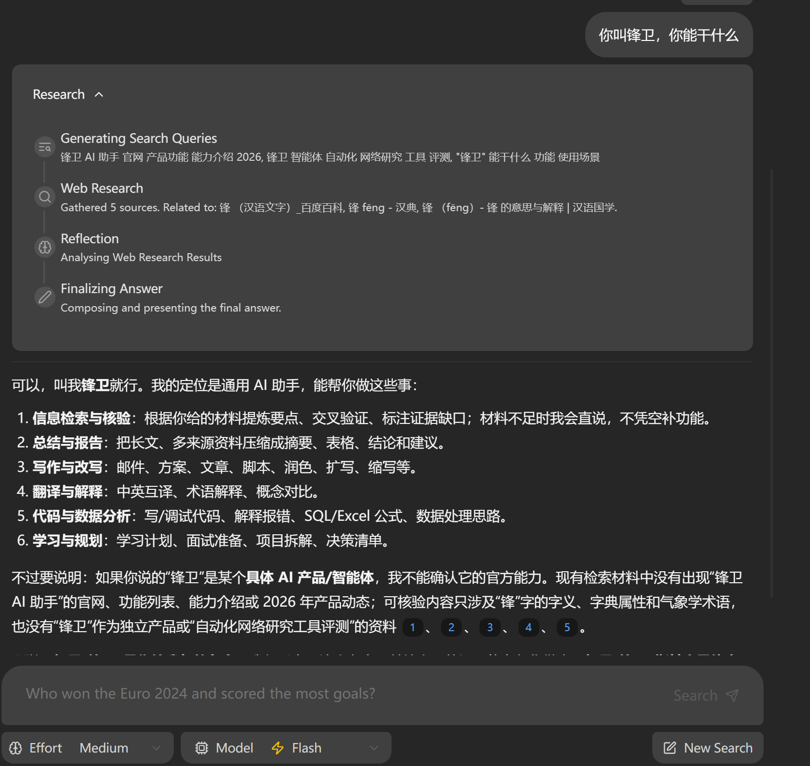
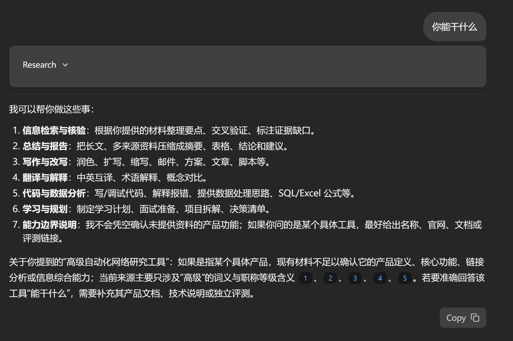
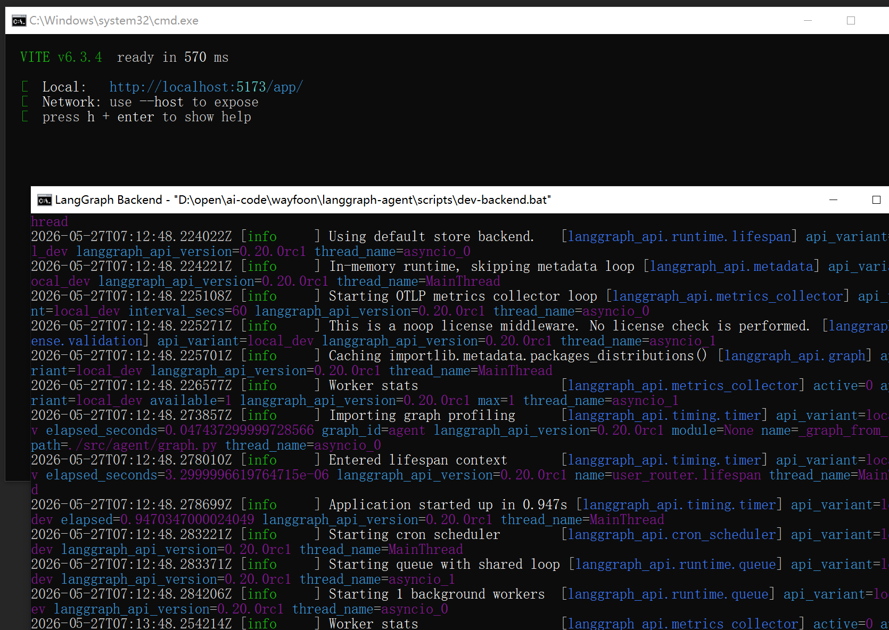

# Full-Stack LangGraph Deep Research Agent

> **[中文文档（默认）/ Chinese Documentation (default)](./README.md)** — Architecture, configuration, and startup instructions.

> React + Vite frontend · LangGraph backend · DeepSeek LLM · Bing web search

A conversational research agent with **web search + citation traceability**. The user asks a question, and the agent automatically breaks it down into multiple search queries → runs concurrent web searches → reflects on whether the information is sufficient → iterates to fill gaps when needed → finally produces a complete answer with numbered citations.

Based on Google's open-source LangGraph example framework, with the model layer and search layer abstracted into switchable providers. DeepSeek and Bing are used by default; Tongyi Qianwen, Ollama, OpenAI, and others are also supported.

> **Note on token usage**: The agent runs a multi-round loop of "generate queries → concurrent search → reflect → iterate to supplement". A single question consumes significantly more tokens than a normal chat API call. The default is 3 initial queries and up to 2 research loops; you can lower these via `number_of_initial_queries` and `max_research_loops` in `configuration.py`.

---

## Table of Contents

- [Core Capabilities](#core-capabilities)
- [Interface Preview](#interface-preview)
- [Technical Architecture](#technical-architecture)
- [Quick Start](#quick-start)
- [Manual Startup (Simplified Git Bash)](#manual-startup-simplified-git-bash)
- [Configuration](#configuration)
- [Project Structure](#project-structure)
- [Production Deployment](#production-deployment)
- [License](#license)

---

## Core Capabilities

| Capability | Description |
| ---------- | ----------- |
| **Automatic query generation** | Breaks the user's natural-language question into 1–N precise search queries |
| **Concurrent web search** | Runs multiple queries in parallel, deduplicates and aggregates results, then feeds them back to the model |
| **Reflection and iteration** | Assesses whether the retrieved material is sufficient and automatically launches another search round when gaps exist (up to 2 rounds by default) |
| **Citation traceability** | Embeds `[1]`, `[2]` markers in the answer, each clickable to jump to the source |
| **Switchable providers** | Both the model layer and the search layer are abstractions — switch vendors by editing only `.env`, no code changes |
| **Frontend/backend hot reload** | Both the backend `langgraph dev` and the frontend Vite support hot updates, so code changes take effect immediately |

---

## Interface Preview

### Research mode: the execution process is traceable

Expand the **Research** panel at the top to see the agent's full execution chain — every step is annotated with what it did and how many pieces of material it collected:



The four phases correspond to four nodes in the backend graph:

| Phase | Node | Meaning |
| ----- | ---- | ------- |
| Generating Search Queries | `generate_query` | Breaks the question into multiple search queries |
| Web Research | `web_research` | Runs concurrent searches and aggregates/deduplicates results |
| Reflection | `reflection` | Assesses information sufficiency and identifies knowledge gaps |
| Finalizing Answer | `finalize_answer` | Combines all material into the final answer with citations |

### Answer results: every conclusion can be traced back to its source



The answer embeds `[1]`, `[2]` markers; clicking one jumps to the corresponding source.
When the retrieved material is insufficient to support a conclusion, the agent **explicitly states that information is insufficient** rather than fabricating an answer — it also lists at the end "what additional material is needed for verification".

---

## Technical Architecture

```
┌─────────────────────────────────────────────────────────┐
│  Frontend  React 19 + Vite 6 + Tailwind CSS 4 + shadcn/ui│
│  http://localhost:5173/app/                              │
└──────────────────────┬──────────────────────────────────┘
                       │ LangGraph SDK (HTTP + SSE streaming)
┌──────────────────────▼──────────────────────────────────┐
│  Backend  LangGraph API (FastAPI)                        │
│  http://127.0.0.1:2024                                  │
│                                                         │
│   generate_query ──► web_research ──► reflection ──┐    │
│         ▲                                           │    │
│         └────────── loop back if insufficient ◄────┘    │
│                                                     │    │
│                                            finalize_answer │
└──────────────────────┬──────────────────────────────────┘
                       │
        ┌──────────────┴──────────────┐
        │                             │
   llm_provider.py               search.py
   deepseek / openai            bing (no API key)
   dashscope / ollama           tavily (API key required)
                                 gemini (native)
```

### Four core nodes

| Node | Responsibility |
| ---- | -------------- |
| `generate_query` | Generates the initial list of search queries |
| `web_research` | Runs searches → hands results to the LLM for cited summarization |
| `reflection` | Determines whether information is sufficient and identifies knowledge gaps |
| `finalize_answer` | Combines all material into the final answer with citations |

### Key designs

**Model abstraction layer** (`backend/src/agent/llm_provider.py`)  
All models are accessed through the OpenAI-compatible protocol; DeepSeek / Tongyi Qianwen / Ollama / OpenAI can all be plugged in. API differences are handled automatically — for example, DeepSeek does not support `json_schema` structured output and only accepts `json_object`, so the provider layer degrades gracefully instead of failing at request time.

**Search abstraction layer** (`backend/src/agent/search.py`)  
The upstream project used Gemini's proprietary `google_search` grounding tool, which is a Google-only capability and unreachable from many corporate networks. This module implements the same contract with three backends — "bing scraping / tavily API / native gemini" — **keeping the output structure unchanged so the frontend needs no changes at all**.

---

## Quick Start

### Prerequisites

- Python 3.11+
- Node.js 18+
- A working LLM API key (DeepSeek by default)

### Windows (CMD) — recommended

```cmd
scripts\dev.bat
```

Two separate windows pop up automatically to run the frontend and backend, so their logs do not interfere with each other.

### Windows (CMD) — manual, separate windows

**Window 1 (backend)**, choose any of the following:

```cmd
REM Option 1: script (built-in UTF-8 environment variables, easiest)
scripts\dev-backend.bat

REM Option 2: single command, no environment variables needed
cd backend
.\.venv\Scripts\python.exe -X utf8 -m langgraph_cli dev --no-browser --port 2024

REM Option 3: activate the virtual environment first, then use the original command
cd backend
.venv\Scripts\activate
.\.venv\Scripts\langgraph.exe dev --no-browser --port 2024
```

**Window 2 (frontend)**:

```cmd
scripts\dev-frontend.bat
```

Or:

```cmd
cd frontend
npm run dev
```

Signs of a successful startup:

```
- 🚀 API: http://127.0.0.1:2024
- 📚 API Docs: http://127.0.0.1:2024/docs
```

```
VITE v6.3.4  ready in 4287 ms
➜  Local:   http://localhost:5173/app/
```

### macOS / Linux / Git Bash

```bash
cd D:/open/ai-code/wayfoon/langgraph-agent
bash scripts/dev.sh
```

The script starts the backend and frontend in order; press `Ctrl+C` to stop both.

### Startup result

After starting with `scripts\dev.bat`, two terminal windows appear — the upper one is the frontend Vite, the lower one is the backend LangGraph:



The backend log showing `Application started up` means the service is ready; once the frontend shows `Local: http://localhost:5173/app/`, you can open a browser.

---

## Manual Startup (Simplified Git Bash)

**Two separate terminal windows are recommended**, so that a backend crash does not wipe out the frontend logs and troubleshooting is easier.

### Window 1: start the backend

```bash
cd D:/open/ai-code/wayfoon/langgraph-agent/backend
./.venv/Scripts/langgraph.exe dev --no-browser --port 2024
```

### Window 2: start the frontend

```bash
cd D:/open/ai-code/wayfoon/langgraph-agent/frontend
npm run dev
```

Signs of a successful startup:

```
VITE v6.3.4  ready in 4287 ms
➜  Local:   http://localhost:5173/app/
```

### Access

Open **<http://localhost:5173/app/>** in your browser.

---

## Configuration

### Model service

| Variable | Description | Default |
| -------- | ----------- | ------- |
| `LLM_PROVIDER` | `deepseek` / `openai` / `dashscope` / `ollama` | `deepseek` |
| `LLM_API_KEY` | API key; if empty, falls back to same-name variables such as `DEEPSEEK_API_KEY` | — |
| `LLM_BASE_URL` | Endpoint address; if empty, uses the provider's default | `https://api.deepseek.com/v1` |
| `LLM_MODEL` | Model ID | `deepseek-flash` |

Available models: `deepseek-flash` (fast, default), `deepseek-v4-pro` (stronger, more expensive).

### Example: switching to another provider

Switch to Tongyi Qianwen:

```bash
LLM_PROVIDER=dashscope
LLM_BASE_URL=https://dashscope.aliyuncs.com/compatible-mode/v1
LLM_MODEL=qwen-plus
LLM_API_KEY=sk-xxxxxxxx
```

Switch to local Ollama:

```bash
LLM_PROVIDER=ollama
LLM_BASE_URL=http://localhost:11434/v1
LLM_MODEL=qwen2.5:7b
```

> Like `deepseek`, `ollama` only supports `json_object` mode; the provider layer already handles this.

---

## Project Structure

```
langgraph-agent/
├── backend/                     # LangGraph backend
│   ├── .env                     # Configuration (API key, not in version control)
│   ├── requirements.lock.txt    # Locked dependency versions
│   ├── langgraph.json           # Graph registry and HTTP app entry
│   ├── pyproject.toml
│   ├── examples/
│   │   └── cli_research.py      # One-off CLI question answering
│   └── src/agent/
│       ├── graph.py             # Graph orchestration: four nodes + conditional edges
│       ├── llm_provider.py      # Model abstraction layer
│       ├── search.py            # Search abstraction layer
│       ├── configuration.py     # Runtime parameters (overridable by frontend dropdowns)
│       ├── state.py             # State definition + deduplication reducer
│       ├── prompts.py           # Prompt templates
│       ├── tools_and_schemas.py # Structured output schemas
│       ├── app.py               # Custom FastAPI application
│       └── utils.py             # Utility functions
├── frontend/                    # React frontend
│   ├── package.json
│   ├── vite.config.ts
│   └── src/
│       ├── App.tsx              # Main container, streaming subscription
│       ├── main.tsx             # Entry point
│       ├── global.css           # Global styles
│       └── components/
│           ├── ChatMessagesView.tsx   # Messages and citation rendering
│           ├── ActivityTimeline.tsx    # Node activity timeline
│           ├── InputForm.tsx          # Input box + model/intensity selection
│           ├── WelcomeScreen.tsx
│           └── ui/                     # shadcn/ui base components
├── docs/
│   └── images/                  # README images
├── scripts/
    ├── dev.sh                   # One-click start (Git Bash / macOS / Linux)
    ├── dev.bat                  # One-click start (Windows CMD, two windows)
    ├── dev-backend.bat          # Backend only (built-in UTF-8 environment variables)
    ├── dev-frontend.bat         # Frontend only
    ├── setup-venv.bat           # Rebuild venv + apply UTF-8 fix automatically
    └── patch_activate_utf8.py   # Inject PYTHONUTF8=1 into activate.bat (idempotent)
```

---

## Production Deployment

Production requires **Redis** (message queue for streaming output) and **PostgreSQL** (storage for assistants / threads / runs and long-term memory).

```bash
docker build -t gemini-fullstack-langgraph -f Dockerfile .
docker compose up
```

Once the service is up, open <http://localhost:8123/app/>.

> A `LANGSMITH_API_KEY` must also be provided for Docker deployment.

---

## License

Based on the official LangGraph example under [Apache License 2.0](LICENSE).
