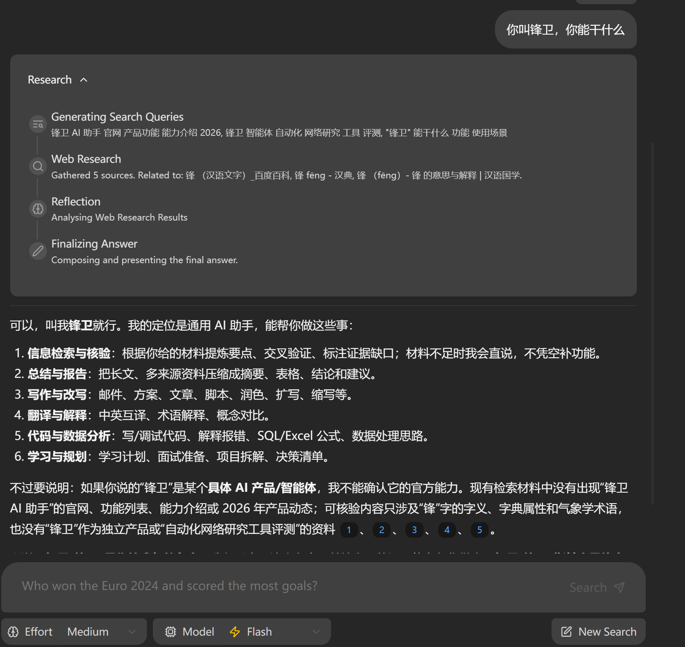
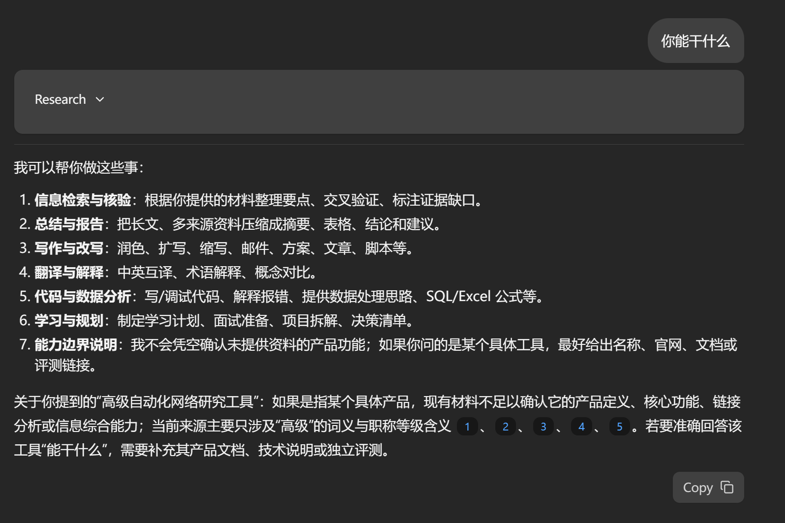
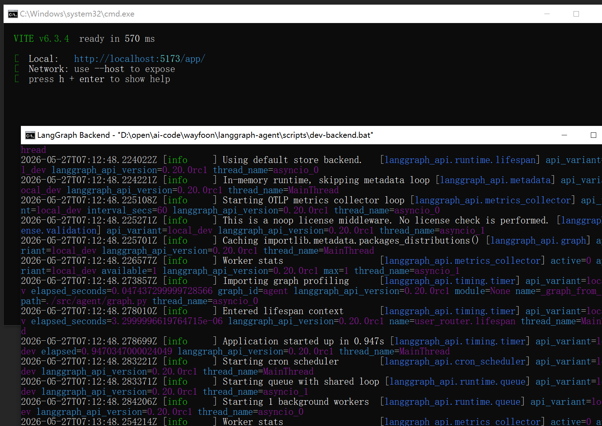

# 全栈 LangGraph 深度研究 Agent

> React + Vite 前端 · LangGraph 后端 · DeepSeek 大模型 · Bing 联网检索

一个具备**联网检索 + 引用溯源**能力的对话式研究 Agent。用户提出问题，Agent 自动拆解为多条搜索查询 → 并发联网检索 → 反思信息是否充分 → 必要时迭代补充 → 最终输出带编号引用的完整回答。

基于 Google 开源的 LangGraph 示例框架改造，将模型层与检索层抽象为可切换的 provider，
默认接入 DeepSeek 与 Bing；已适配通义千问、Ollama、OpenAI 等模型。

> **注意 Token 消耗**：Agent 会执行「生成查询 → 并发检索 → 反思 → 迭代补充」多轮循环，
> 单次提问的 Token 消耗显著高于普通对话 API。默认 3 条初始查询、最多 2 轮研究循环，
> 可通过 `configuration.py` 中的 `number_of_initial_queries` 与 `max_research_loops` 下调。

---

## 目录

- [核心能力](#核心能力)
- [界面预览](#界面预览)
- [技术架构](#技术架构)
- [快速启动](#快速启动)
- [手工启动（Git Bash 简版）](#手工启动git-bash-简版)
- [配置说明](#配置说明)
- [项目结构](#项目结构)
- [生产部署](#生产部署)
- [许可](#许可)

---

## 核心能力

| 能力             | 说明                                                                  |
| ---------------- | --------------------------------------------------------------------- |
| **查询自动生成** | 把用户的自然语言问题拆解成 1～N 条精准搜索查询                        |
| **并发联网检索** | 多条查询并行发起，汇总去重后回灌给模型                                |
| **反思迭代**     | 评估检索材料的充分性，有信息缺口时自动补充新一轮检索（默认最多 2 轮） |
| **引用溯源**     | 回答中嵌入 `[1]`、`[2]` 编号，可点击跳转原文                          |
| **供应商可切换** | 模型层、检索层均为抽象层，换厂商只改 `.env`，不动代码                 |
| **前后端热重载** | 后端 `langgraph dev` 与前端 Vite 均支持热更新，改代码即时生效         |

---

## 界面预览

### 研究模式：执行过程可追溯

展开顶部的 **Research** 面板，可以看到 Agent 的完整执行链路 —— 每一步都标注了做了什么、
收集到多少条素材：



四个阶段对应后端图的四个节点：

| 阶段                      | 对应节点          | 含义                               |
| ------------------------- | ----------------- | ---------------------------------- |
| Generating Search Queries | `generate_query`  | 把问题拆解为多条搜索查询           |
| Web Research              | `web_research`    | 并发检索并汇总去重                 |
| Reflection                | `reflection`      | 评估信息充分性，识别知识缺口       |
| Finalizing Answer         | `finalize_answer` | 综合所有素材，生成带引用的最终回答 |

### 回答结果：每条结论都可回溯原文



回答正文中嵌入 `[1]`、`[2]` 编号，点击即可跳转到对应来源。
当检索材料不足以支撑结论时，Agent 会**明确说明信息不足**，而不是编造答案 —— 末尾还会列出
「需要补充哪些材料才能核验」。

---

## 技术架构

```
┌─────────────────────────────────────────────────────────┐
│  前端  React 19 + Vite 6 + Tailwind CSS 4 + shadcn/ui   │
│  http://localhost:5173/app/                              │
└──────────────────────┬──────────────────────────────────┘
                       │ LangGraph SDK (HTTP + SSE 流式)
┌──────────────────────▼──────────────────────────────────┐
│  后端  LangGraph API (FastAPI)                          │
│  http://127.0.0.1:2024                                  │
│                                                         │
│   generate_query ──► web_research ──► reflection ──┐    │
│         ▲                                           │    │
│         └────────── 信息不足则回环 ◄───────────────┘    │
│                                                     │    │
│                                            finalize_answer │
└──────────────────────┬──────────────────────────────────┘
                       │
        ┌──────────────┴──────────────┐
        │                             │
   llm_provider.py               search.py
   deepseek / openai            bing（免 Key）
   dashscope / ollama           tavily（需 Key）
                                 gemini（原生）
```

### 四个核心节点

| 节点              | 职责                               |
| ----------------- | ---------------------------------- |
| `generate_query`  | 生成初始搜索查询列表               |
| `web_research`    | 执行检索 → 交给 LLM 带引用地总结   |
| `reflection`      | 判断信息是否充分，识别知识缺口     |
| `finalize_answer` | 综合所有材料，输出带引用的最终回答 |

### 关键设计

**模型抽象层**（`backend/src/agent/llm_provider.py`）  
统一走 OpenAI 兼容协议，DeepSeek / 通义千问 / Ollama / OpenAI 均可接入。自动处理各家 API 差异 —— 例如 DeepSeek 不支持 `json_schema` 结构化输出，只接受 `json_object`，provider 层会自动降级，避免请求时才报错。

**检索抽象层**（`backend/src/agent/search.py`）  
上游项目使用 Gemini 专属的 `google_search` grounding 工具，该接口是 Google 私有能力、在多数企业网络不可达。本模块以「bing 抓取 / tavily API / gemini 原生」三种后端实现同一份契约，**保持输出结构不变，前端无需任何改动**。

---

## 快速启动

### 前置要求

- Python 3.11+
- Node.js 18+
- 一个可用的大模型 API Key（默认 DeepSeek）

### Windows（CMD）—— 推荐

```cmd
scripts\dev.bat
```

自动弹出两个独立窗口分别跑前后端，日志互不干扰。

### Windows（CMD）—— 手工分窗口

**窗口一（后端）**，任选一种：

```cmd
REM 方式 1：脚本（内置 UTF-8 环境变量，最省心）
scripts\dev-backend.bat

REM 方式 2：单行命令，无需设任何环境变量
cd backend
.\.venv\Scripts\python.exe -X utf8 -m langgraph_cli dev --no-browser --port 2024

REM 方式 3：先激活虚拟环境，再用原命令
cd backend
.venv\Scripts\activate
.\.venv\Scripts\langgraph.exe dev --no-browser --port 2024
```

**窗口二（前端）**：

```cmd
scripts\dev-frontend.bat
```

或：

```cmd
cd frontend
npm run dev
```

启动成功标志：

```
- 🚀 API: http://127.0.0.1:2024
- 📚 API Docs: http://127.0.0.1:2024/docs
```

```
VITE v6.3.4  ready in 4287 ms
➜  Local:   http://localhost:5173/app/
```

### macOS / Linux / Git Bash

```bash
cd D:/open/ai-code/wayfoon/langgraph-agent
bash scripts/dev.sh
```

脚本会依次拉起后端和前端，按 `Ctrl+C` 一并停止。

### 启动效果

用 `scripts\dev.bat` 启动后，会弹出两个终端窗口 —— 上方是前端 Vite，下方是后端 LangGraph：



后端日志出现 `Application started up` 即表示服务就绪；前端显示 `Local: http://localhost:5173/app/` 后即可打开浏览器。

---

## 手工启动（Git Bash 简版）

**推荐用两个独立的终端窗口**，这样后端崩溃时前端日志不会被冲掉，日志更好排查。

### 窗口一：启动后端

```bash
cd D:/open/ai-code/wayfoon/langgraph-agent/backend
./.venv/Scripts/langgraph.exe dev --no-browser --port 2024
```

### 窗口二：启动前端

```bash
cd D:/open/ai-code/wayfoon/langgraph-agent/frontend
npm run dev
```

启动成功标志：

```
VITE v6.3.4  ready in 4287 ms
➜  Local:   http://localhost:5173/app/
```

### 访问

浏览器打开 **<http://localhost:5173/app/>**

---

## 配置说明

### 模型服务

| 变量           | 说明                                                    | 默认值                        |
| -------------- | ------------------------------------------------------- | ----------------------------- |
| `LLM_PROVIDER` | `deepseek` / `openai` / `dashscope` / `ollama`          | `deepseek`                    |
| `LLM_API_KEY`  | API Key，留空则回退到 `DEEPSEEK_API_KEY` 等同名环境变量 | —                             |
| `LLM_BASE_URL` | 接口地址，留空用供应商默认地址                          | `https://api.deepseek.com/v1` |
| `LLM_MODEL`    | 模型 ID                                                 | `deepseek-flash`              |

当前可用模型：`deepseek-flash`（快、默认）、`deepseek-v4-pro`（强、贵）。

### 切换到其他供应商示例

换成通义千问：

```bash
LLM_PROVIDER=dashscope
LLM_BASE_URL=https://dashscope.aliyuncs.com/compatible-mode/v1
LLM_MODEL=qwen-plus
LLM_API_KEY=sk-xxxxxxxx
```

换成本地 Ollama：

```bash
LLM_PROVIDER=ollama
LLM_BASE_URL=http://localhost:11434/v1
LLM_MODEL=qwen2.5:7b
```

> `ollama` 与 `deepseek` 一样只支持 `json_object` 模式，provider 层已自动处理。

---

## 项目结构

```
langgraph-agent/
├── backend/                     # LangGraph 后端
│   ├── .env                     # 配置（API Key，不入版本库）
│   ├── requirements.lock.txt    # 依赖版本锁定
│   ├── langgraph.json           # 图注册与 HTTP 应用入口
│   ├── pyproject.toml
│   ├── examples/
│   │   └── cli_research.py      # 命令行单次问答
│   └── src/agent/
│       ├── graph.py             # 图编排：四个节点 + 条件边
│       ├── llm_provider.py     # 模型抽象层
│       ├── search.py            # 检索抽象层
│       ├── configuration.py     # 运行期参数（可被前端下拉框覆盖）
│       ├── state.py             # 状态定义 + 去重 reducer
│       ├── prompts.py           # 提示词模板
│       ├── tools_and_schemas.py # 结构化输出 schema
│       ├── app.py               # FastAPI 自定义应用
│       └── utils.py             # 工具函数
├── frontend/                    # React 前端
│   ├── package.json
│   ├── vite.config.ts
│   └── src/
│       ├── App.tsx              # 主容器，流式订阅
│       ├── main.tsx             # 入口
│       ├── global.css           # 全局样式
│       └── components/
│           ├── ChatMessagesView.tsx   # 消息与引用渲染
│           ├── ActivityTimeline.tsx    # 节点活动时间线
│           ├── InputForm.tsx          # 输入框 + 模型/强度选择
│           ├── WelcomeScreen.tsx
│           └── ui/                     # shadcn/ui 基础组件
├── docs/
│   └── images/                  # README 配图
├── scripts/
    ├── dev.sh                   # 一键启动（Git Bash / macOS / Linux）
    ├── dev.bat                  # 一键启动（Windows CMD，弹两个窗口）
    ├── dev-backend.bat          # 仅启动后端（内置 UTF-8 环境变量）
    ├── dev-frontend.bat         # 仅启动前端
    ├── setup-venv.bat           # 重建虚拟环境 + 自动应用 UTF-8 修复
    └── patch_activate_utf8.py   # 向 activate.bat 注入 PYTHONUTF8=1（幂等）
```

---

## 生产部署

生产环境需要 **Redis**（消息队列，用于流式输出）与 **PostgreSQL**（存储 assistants / threads / runs 及长期记忆）。

```bash
docker build -t gemini-fullstack-langgraph -f Dockerfile .
docker compose up
```

服务启动后访问 <http://localhost:8123/app/>。

> Docker 部署时需额外提供 `LANGSMITH_API_KEY`。

---

## 许可

基于 [Apache License 2.0](LICENSE) 的 LangGraph 官方示例改造而来。
